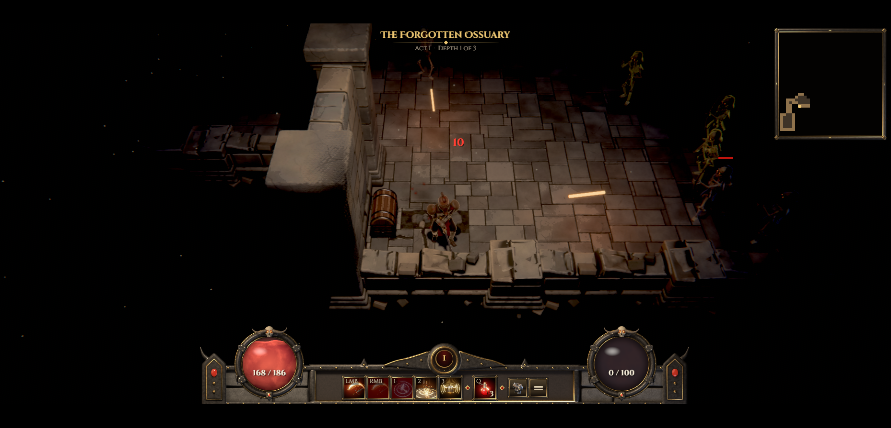

# BLOOD SLAYERS — offline mirror

Full mirror of **BLOOD SLAYERS** (https://wavedash.com/games/blood-slayers), the
"olbaid" WebGPU action RPG served by the Wavedash platform.

Source: https://wavedash.com/games/blood-slayers



## Stack

- **Custom "olbaid" engine — Rust → WebAssembly + WebGPU.** The game is not
  Unity/Godot/Unreal: `olbaid_bg.wasm` (34.7 MB) is a Rust/wasm-bindgen build
  with Bevy crates vendored in (bevy_pbr / bevy_core_pipeline / bevy_ui_render
  shaders and reflection tables are visible in the payload), a winit browser
  event loop and a hand-written wgpu renderer — the entry document refuses to
  boot without `navigator.gpu` and drives the load bar from Rust
  (`window.olbaidProgress` / `window.olbaidReady`).
- **Hand-written entry + wasm-bindgen glue.** `index.html` is authored source
  (canvas page, iOS gesture/audio shims, `import("./olbaid.js")`);
  `olbaid.js` is the 184 KB wasm-bindgen glue with the
  `snippets/olbaid-abdb8433e54eccc9/` JS shims (`inline0.js`,
  `web/olbaid_net.js` — the Wavedash SDK bridge for parties/Quick Play/P2P —
  and `web/olbaid_save.js` — cloud saves).
- **Wavedash platform delivery (the platform mechanics).** The game page on
  wavedash.com is a SvelteKit shell; the game itself is served by a **per-user,
  per-build CDN host**:
  `https://<gameCloudId>-<fnv32(userId)>-<fnv32(gameBuildId)>.builds.wavedashcdn.com`.
  The page's SSR HTML carries the rotating **playKey**; the player iframe
  requests `/embed?entrypoint=index.html&engine=CUSTOM&pk=<playKey>&sdkconfig=…`,
  which answers an embed shell embedding
  `window.__WAVEDASH_GAME__ = {gcid, gbid, swPath, gameplayJwt, sessionToken}`
  (JWT ≈ 1 h). `sw-embed.js` — a service worker registered at the host's root
  scope — attaches `Authorization: Bearer <gameplayJwt>` + `X-Wd-Sw: jwt` to
  every build-file request, refreshes it via `POST /auth/refresh`, and caches
  immutable build files (`build-file-cache`). `embed.js` is the Wavedash SDK
  that boots the game document and exposes `window.Wavedash` to the Rust side.
  Without the JWT every path 401s (except `/embed.js`, `/embed.css`,
  `/sw-embed.js`, which are public).
- **Account/party features stay platform-side.** Convex
  (`convex-api.wavedash.com`) backs lobbies/rosters/cloud saves; UGC and
  userfs go to `ugc.wavedashcdn.com` / `uploads.wavedash.com`; error reports
  go to Sentry. These endpoints are documented gaps, not captured bytes. The
  mirror boots **"PLAYING SOLO"** — the game is fully playable offline; a
  local character (creation, dungeon, combat, death/resurrect) was verified.

## What this is

BLOOD SLAYERS — "The Five Seals" — is a 1.1.1 WebGPU action RPG (What To Do!?
Games) for 1–4 players: pick a Barbarian-Knight or a Sorcerer, fight down
through procedurally-carved Ossuary floors (crypts, catacombs, …), hunt the
Keywarden, break the Warden seals and take the loot. The mirror captures the
game's complete build-host closure: **414 files, 255,812,894 bytes (244.0
MiB)** — entry, wasm engine payload, wasm-bindgen shims, the Wavedash embed
shell (embed, embed.js, embed.css, sw-embed.js) and the entire asset tree:
10 themed environment sets (all nine theme prefixes plus the generic crypt
set, with floor depth maps), 20 character/monster models, 43 gear models, 4
item models, 45 icons, 20 UI sheets, 78 audio tracks (SFX + music + voice),
2 fonts, 5 WGSL shaders and 30 `_depth.png` floor maps.

The asset universe was closed **network-log-led**: a full browser session
recorded the platform load, the embed boot and the game's own fetches
(`docs/network-log-2026-10-13.jsonl`), and the game's embedded tables were
recovered from the wasm (the Rust payload compiles in its region list and the
full scene-object name table via `include_str!` — 9 theme prefixes × props,
the 17 monster keys, the 29 gear looks, every icon/UI/audio name). Every
candidate was probed with a session JWT; 404s are recorded in
`_mirror-report.json` (e.g. `*_wall_c` exists only for drowned/thorn/foundry/
abyss, staves only for the sorcerer body, weapons only for the hero body,
`mock-wavedash.js` is referenced by the `?mock=1` local-testing branch but
never uploaded). The platform reports `buildSizeBytes 347,715,998` for build
20; the captured 244.0 MiB is every byte any runtime request reaches — the
delta is upload-side build metadata/artifacts not addressable from the CDN
host (probed exhaustively, including `*.gz`/`*.br`/manifest paths).

External at runtime (documented gaps, not captured — PLAN §1/§4): the Convex
backend, uploads/UGC hosts, Google sign-in and Sentry, all listed in
`_mirror-report.json`.

Platform page vs game build: wavedash.com/games/blood-slayers is **platform
chrome** (nav, store text, comments, platform auth) and is not captured; the
**game closure** lives entirely on the build host and is captured at the repo
root, so serving this repo root reproduces the build host's paths 1:1
(`/index.html`, `/olbaid.js`, `/assets/…`, `/embed`, `/embed.js`,
`/sw-embed.js`). The captured `embed` document is a snapshot of one response
and therefore carries one (long-expired, anonymous-session) `gameplayJwt` +
`sessionToken` pair — it is recorded byte-exact as served and marked
`dynamic: true` in the manifest (the probe compares it token-normalized).

## Layout

- `index.html`, `olbaid.js`, `olbaid_bg.wasm`, `snippets/…` — the game's own
  closure, at the build host's root paths.
- `embed`, `embed.js`, `embed.css`, `sw-embed.js` — the Wavedash embed shell /
  platform runtime (vendor; the `embed` file is extensionless HTML).
- `assets/` — the full asset tree (see `## Assets`).
- `.upstream/manifest.json` — sha256 for every captured file (Gen-A)
- `readable/` — prettified derived layer (pinned prettier 3.9.6): the olbaid
  glue, the three wasm-bindgen shims, the Wavedash SDK + service worker
  (vendor, whole-file), `embed.css`, and the inline twins of `index.html`
  (style + 2 scripts) and `embed` (config script), plus
  `index-inline-map.json` (inline byte ranges + sha256)
- `src/` + `split-spec.json` — 12 statement-aligned slices of the app-side JS
  (glue, shims, inline boot module) with the recorded derivation spec
- `tools/derive.mjs` — rebuild `readable/` + `src/` + `split-spec.json`
- `tools/capture.mjs` — (re)fetch the build closure with a session JWT
- `tools/update.mjs` — read-only drift probe (mints a fresh pk/JWT itself)
- `tools/verify.mjs` — re-hash the capture against the manifest
- `tools/audit.js` — integrity gate for the derived layers (`AUDIT PASS`)
- `docs/cover.png` — cover (gameplay: the Barbarian-Knight fighting risen
  skeletons in the Forgotten Ossuary, mirror-served), `docs/boot-2026-10-13.png`
  — boot evidence (offline character screen), `docs/network-log-2026-10-13.jsonl`
  — the browser/runtime network record

## Assets

- **models — environment** — 160 file(s): `assets/models/env/` — 10 themed
  sets (generic crypt + catacomb/cathedral/sunken/hellforge/cavern/drowned/
  thorn/foundry/abyss × floors a/b/c, walls, pillars) plus props (chests,
  braziers, banners, levers, gates, decals…) and 30 `*_depth.png` floor maps
- **models — characters** — 20 file(s): `assets/models/characters/` — hero,
  sorcerer, and the bestiary (skeleton_warrior, skeleton_archer, ghoul,
  drowned_thrall, tidecaller, drowned_warden, thorn_penitent,
  weeping_chorister, weeping_saint, ash_smith, cinder_hurler, forgemaster,
  hollow_sentinel, abyss_seer, void_spawn, hollow_king, boss, skeleton_parts)
- **models — gear** — 43 file(s): `assets/models/gear/hero/`,
  `assets/models/gear/sorcerer/` (weapons/armour looks that show on the hero)
- **models — items** — 4 file(s): `assets/models/items/` (ring, amulet, gold,
  potion)
- **images — icons** — 45 file(s): `assets/icons/` (item_*, skill_*, class_*)
- **images — UI** — 20 file(s): `assets/ui/` (HUD orbs/bars, panels, worldmap,
  cutscene and intro/ending art, map fog/tokens)
- **audio** — 78 file(s): `assets/audio/` (68 SFX, `music/` — village/demons_lair/
  the_pit tracks, `voice/` — 5 narrator takes, plus intro/ending/cutscene themes)
- **fonts** — 2 file(s): `assets/fonts/` (Cinzel, CinzelDecorative-Bold)
- **shaders** — 5 file(s): `assets/shaders/` (orb, fx, occluder, spell, character)
- **engine payload** — `olbaid_bg.wasm` (34.7 MB Rust/wasm, notRendered)

## Run

Serve this repo root with any static file server (the capture is a static
site; no build step):

```
npx serve .
```

Then open `http://localhost:<port>/index.html` — the game boots standalone
offline ("PLAYING SOLO") straight into character creation/play. The build
host's own boot path is also reproduced: `/embed?entrypoint=index.html&engine=CUSTOM&sdkconfig=<json>`.
Note the origin's build host sends cross-origin-isolation headers
(`Cross-Origin-Opener-Policy: same-origin`, `Cross-Origin-Embedder-Policy:
require-corp`); the boot below was verified with a static server that mirrors
them. The platform backend calls fail offline exactly as expected (no roster/
cloud saves) and the game degrades to solo play.

## Verify

```
node tools/verify.mjs     # re-hash the capture against the manifest
node tools/audit.js       # derived-layer integrity gate (AUDIT PASS)
node tools/check-exports.mjs   # the derived layer still exports every public name
```

## Updating from upstream

```
node tools/update.mjs     # read-only drift probe (mints its own pk/JWT)
```

The probe re-derives the per-build CDN host from the live game page, mints a
fresh anonymous playKey → gameplay JWT, and re-hashes every captured file
against the manifest (the `embed` shell is compared token-normalized). The
probe never rewrites the capture — a mirror is a point-in-time snapshot.
Refreshing means `node tools/capture.mjs` into a clean tree, then
`node tools/make-manifest.mjs . .upstream/manifest.json`, then re-deriving
(`node tools/derive.mjs` + `node tools/audit.js`).

### 2026-10-13 derivation note

Both derived layers are in place, cut from the recorded capture (capture bytes
untouched — `node tools/verify.mjs` re-hashes all 414 files):

- `readable/` — pinned prettier 3.9.6 (module API, default options, single
  pass verified idempotent — never the CLI, it respects `.gitignore` and can
  silently echo its input) rendered 9 whole-file pretties (olbaid glue, 3
  wasm-bindgen shims, the Wavedash SDK `embed.pretty.js` at 23,054 lines, its
  service worker, `embed.pretty.css`) and 4 inline twins (`index-inline-1`
  style, `index-inline-1`/`2` scripts, `embed-inline-1` config), 11 files in
  total; every pretty is provably not a byte copy of its capture source and
  re-renders byte-exact under the pinned version. Names are repo-root-relative
  with dirs flattened with `__`; the `embed` shell's inline config twins under
  `embed-inline-1` and its byte range + sha256 are recorded in
  `readable/index-inline-map.json`.
- `src/` — 12 statement-aligned slices with the exact 2-line provenance
  header: 5 from the wasm-bindgen glue (`olbaid-01..05`, 5,971 readable lines
  sliced at top-level declaration boundaries, ~250-350-line windows — the
  oversized single declarations stay whole), 2 from the `olbaid_net` SDK
  bridge, 1 each from `inline0`/`olbaid_save`, and 1 each from the three
  inline scripts. 12/12 parse standalone (`node --input-type=module --check -`)
  and round-trip byte-exact to their readable line ranges. This is a
  **loader-only src/ layer** (glue + platform bridge + boot module) and it is
  documented as such: the game's gameplay code is inside `olbaid_bg.wasm`,
  recorded hashed-notRendered per the fleet's engine-build precedent (payloads
  are never prettified or re-encoded; a naive static server serves them raw).
- Vendor/machinery rule — wholeFile sections, never sliced: `embed.js` +
  `sw-embed.js` (third-party Wavedash platform runtime) and `embed.css`.
  One skipped section: a final pure `export {…}` table, if present. The tail
  records the served chunk's own export statement (`olbaid.js`) as its `text`,
  so the public-export-name gate compares the reading copy's rendered table
  against the served chunk instead of reporting that table unchecked; the
  wholeFile sections name the served capture path in `file`, so the gate can
  resolve the text behind them.
- Identifiers in src/ are the glue's own (wasm-bindgen) names — the
  identifier-rename campaign (PLAN §5) is an explicit **open task** for this
  mirror (there is no authored JS app layer to rename beyond the glue).
- §0.4 fork-over-mirror checked 2026-10-13: no public source repo exists for
  Blood Slayers — the game page links only platform pages (the developer
  profile and Wavedash's own org), a GitHub search finds only this mirror, and
  "olbaid" has no matching source project. The mirror stands.
- Network-log-led closure: the platform load, embed boot and the game's own
  fetches were recorded in a browser session, and the assets not reached in
  that instance were recovered from the wasm-embedded tables and probed (this
  is why both `catacomb_*` and generic `floor_*` sets — run-dependent level
  themes — are captured). OOPIF caveat: the game iframe is a cross-origin
  out-of-process frame, so `opencli network` sees only the navigation-level
  requests; the asset burst was recorded with an in-page fetch hook and the
  Service Worker's cache keys (both in `docs/network-log-2026-10-13.jsonl`).
- Gates: `node tools/verify.mjs` → `414 files checked, 0 problems`;
  `node tools/update.mjs` → `up to date: 414 captured files identical upstream
  (build 0a5301b2)`; `node tools/audit.js` → `AUDIT PASS` (12/12 round-trips,
  11/11 pretties re-render byte-exact, 4 inline twins with byte ranges,
  16/17 imports resolve, 1 whitelisted); serve probe — repo root served on
  loopback, `/`, `/embed`, `/olbaid_bg.wasm` (application/wasm) and
  `assets/models/env/floor_a.glb` over HTTP 200, listener killed, port closed
  (netstat). Boot: the mirror renders and plays offline — character creation,
  the Forgotten Ossuary, combat with risen skeletons, death/resurrect; cover
  and boot evidence in `docs/`. Rebuild with `node tools/derive.mjs`.

## Mirror conventions

- **Capture layer** — the captured files are byte-exact copies of what the
  origin served; nothing in them is edited.
- **Readable layer** — `readable/` is derived (prettified) and never shipped to
  a browser; it exists so the bundles can actually be read.
- **Payload rule** — `olbaid_bg.wasm` and every asset are recorded hashed, never
  rewritten; vendor files stay byte-exact as served.
- **Provenance** — `.upstream/manifest.json` records sha256 for each captured
  artifact, and `tools/verify.mjs` re-checks it.
- **Drift** — `tools/update.mjs` is read-only: it reports what changed upstream
  and never rewrites the capture.

## Fleet status

<!-- mirror-status:start — feeds _standard/REPO-INDEX.md. Update ONLY your own mirror's block; never edit the shared index (PLAN §8). Rebuild: node _standard/build-index.mjs -->
<!-- cols: cls=classification · ver=verify 0 problems · upd=drift probe · man=manifest · rdbl=readable re-derived · src=reversed src · boot=boot test · top=offline-mirror topic · tag=backup tag · staged=staged not committed -->
| # | repo | cls | ver | upd | man | rdbl | src | boot | top | tag | staged |
|---|---|---|---|---|---|---|---|---|---|---|---|
| 311 | blood-slayers | mirror | ✓ | ✓ | ✓ | ✓ | ✓ | ✓ | ✓ | — | — |
<!-- mirror-status:end -->
